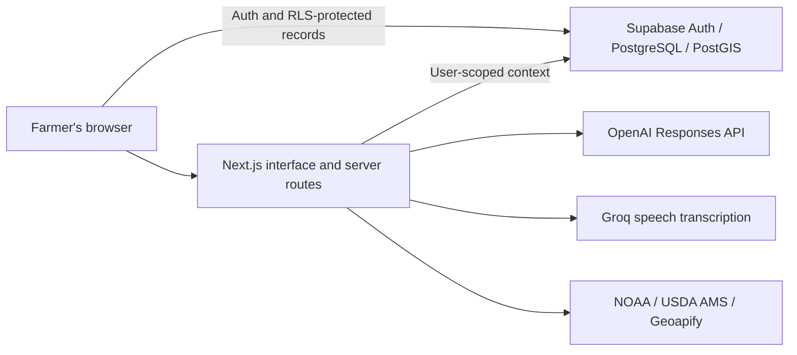

# HarvestCompass

**Plan Smarter. Harvest Better.**

HarvestCompass is a farm operations and decision-support MVP for Midwest corn and soybean farmers. It connects field boundaries, seasonal work, equipment costs, harvest records and grain sales in one farm workspace. A context-aware assistant helps explain records and compare scenarios; farmers review proposed changes before applying them.

Built for the **Wildfire Labs Ignite Hackathon, November 15, 2026** by **10inKL**: Bhupendra Bohara, Krish Kushwaha, Anurag Thapa Magar and Nimesh Shrestha.

[Local setup](#run-locally) · [AI architecture](#how-the-ai-works) · [Database setup](#supabase-setup) · [Field data setup](docs/FIELD_DATA.md) · [Demo walkthrough](docs/DEMO_GUIDE.md)

## What works

| Area | Current functionality |
| --- | --- |
| Welcome and accounts | Public welcome page, separate read-only demo, email/password signup, confirmation, sign-in, password recovery and first-farm setup. |
| Overview | Farm greeting, saved-record totals, open tasks, field progress, weather, regional grain cash bids and PDF report download. |
| Farm Map | Leaflet satellite/street map; nationwide US place/address/ZIP search, coordinate lookup and saved-field suggestions; selectable USDA estimates in the pilot counties; manual drawing, editing, crop assignment and confirmation. |
| Farm Operations | Saved fields and planting status; equipment readiness and owned/rented access; entered rental rates, expected use and estimates; linking recorded equipment costs to the expense ledger. |
| Action Plan | Add, edit, complete and reopen operational tasks. Review assistant-created task proposals before approval. |
| Harvest and inventory | Record field harvests, measured moisture and storage bins; enter grain sales and buyer details; calculate recorded inventory and sales revenue. |
| Reports & History | Record expenses, view category charts and crop summaries, and download an organized farm report as PDF. |
| AI Assistant | Multi-turn streaming chat, saved conversations, farm-data tools, deterministic scenario calculations, source references and hold-to-talk voice input. |
| Farm Settings | Farm profile, multiple farm workspaces, forecast town/field selection and advanced assistant connection settings. |

Demo records are labeled **Demo Farm** and remain separate from authenticated farmers’ records. New accounts start with their own empty workspace. A planning estimate is not automatically a recorded expense, a USDA bid is not a completed sale, and field progress is not measured yield.

## Technology and architecture

| Layer | Implementation |
| --- | --- |
| Web application | Next.js 16.4.6 App Router, React 19.3, TypeScript |
| Interface | Tailwind CSS 4, CSS Modules, Lucide icons, Recharts |
| Authentication and database | Supabase Auth, PostgreSQL, row-level security (RLS) and PostGIS |
| Map | Leaflet; Esri World Imagery and OpenStreetMap street tiles with attribution |
| Assistant | Official OpenAI Node SDK and Responses API; default model `gpt-5-mini` |
| Voice transcription | Groq’s OpenAI-compatible audio endpoint; default `whisper-large-v3-turbo` |
| Forecasts | NOAA National Weather Service API |
| Location search | Geoapify, restricted to US results, independently of field-boundary coverage |
| Grain market data | USDA AMS My Market News, South Dakota Daily Grain Bids, report 3186 |
| PDF generation | jsPDF and jsPDF-AutoTable |
| Field-data preparation | Python scripts; optional local SQLite R-tree spatial index |
| Verification | ESLint, TypeScript/build checks and Node’s test runner |

The application uses a single Next.js project with reusable components and server routes, backed by the existing Supabase database. Browser record writes use the signed-in user’s Supabase session and RLS. Server routes authenticate users before accessing private farm context or credentialed services.



### How the AI works

The copilot is a **tool-augmented large language model using structured farm context**. HarvestCompass does not train or fine-tune its own model. There is no custom RLHF training pipeline, vector database or embedding-based document search in this MVP.

1. A signed-in farmer sends a message. The server verifies the user and active farm membership.
2. It loads saved farm context and up to 20 recent conversation messages.
3. OpenAI selects relevant server-side tools automatically. Their arguments are validated; calculations run in deterministic TypeScript functions.
4. Text streams to the interface. The completed answer and source references are saved in Supabase.
5. A requested task change becomes a separate pending proposal. Approval calls an authenticated database function; generating advice does not apply the change.

Available tools: `get_farm_profile`, `get_fields`, `get_equipment`, `get_tasks`, `get_budget`, `get_harvest_progress`, `get_weather_forecast`, `calculate_expected_production`, `compare_equipment_scenarios` and `propose_plan_changes`.

`OPENAI_MODEL` overrides the default model. The code requests concise replies, with low reasoning effort and verbosity for GPT-5 models, and a 3,000-output-token allowance per model call. This is a generation limit, not a guarantee that every request completes. API failures and incomplete answers are surfaced to the user.

The assistant must distinguish entered records, measured observations and estimates. It must not invent farm records, weather, prices or supplier quotes, or declare harvest readiness without necessary measurements. These are application instructions and validation safeguards, not a guarantee that model output is correct.

## Run locally

Use **Node.js 24 or newer**, npm and Git on macOS, Windows or Linux. The map backend uses Node’s built-in `node:sqlite`; older Node versions may fail even when Next.js itself starts. Python is needed only to prepare boundary data, not to run the web app against an already prepared database.

```bash
git clone https://github.com/10inKL/Harvest-Compass.git
cd Harvest-Compass
npm ci
npm run dev
```

Open [http://localhost:3000](http://localhost:3000). The public `/demo` preview can be explored without credentials. Without Supabase configuration, local demo records can be stored in this browser; they are not shared with teammates. Private authentication, persistent chat and live assistant features require configuration.

For live features, copy `.env.example` to `.env.local` in the **same folder as `package.json`**. On macOS/Linux, use `cp .env.example .env.local`; in Windows PowerShell, use `Copy-Item .env.example .env.local`. If `.env.local` already exists, edit it instead of replacing it. Restart the dev server after changes.

| Variable | Purpose | Needed for |
| --- | --- | --- |
| `NEXT_PUBLIC_SUPABASE_URL` | Supabase project URL | Accounts and hosted records |
| `NEXT_PUBLIC_SUPABASE_PUBLISHABLE_KEY` | Supabase publishable client key | Accounts and hosted records |
| `OPENAI_API_KEY` | Server-side OpenAI credential | Assistant replies and PDF AI assessment |
| `OPENAI_MODEL` | Model override; default `gpt-5-mini` | Optional |
| `GEOAPIFY_API_KEY` | Server-side location-search credential | Town/address/ZIP autocomplete and place-based forecast setup |
| `GROQ_API_KEY` | Separate server-side Groq credential | Voice input only |
| `GROQ_TRANSCRIPTION_MODEL` | Default `whisper-large-v3-turbo`; also accepts `whisper-large-v3` | Optional |
| `USDA_MARKET_NEWS_API_KEY` | Server-side USDA My Market News credential | Regional grain cash bids |

Only the two Supabase client settings use `NEXT_PUBLIC_`. Never give that prefix to provider secrets or use a Supabase service-role key in the browser. `.env.local` is ignored by Git. Settings show configuration status; there is no insecure in-app key-saving endpoint.

OpenAI calls require an API account with available usage credit. USDA Market News API access is free; Groq and Geoapify have free usage options with their own quotas. NOAA does not require an API key. No integration automatically purchases a plan or switches to a paid fallback. See the providers’ current terms before deployment.

## Supabase setup

For a **new database**, apply every file in `supabase/migrations/` in filename order:

1. `202611140001_initial.sql` — farms, memberships, fields, tasks, expenses, equipment and RLS.
2. `202611150001_harvest_entries.sql` — field-linked harvest records.
3. `202611150002_assistant.sql` — conversations, messages, proposals, approval function and forecast coordinates.
4. `202611150003_field_boundaries.sql` — saved field geometries and confirmation metadata.
5. `202611150004_csb_boundaries.sql` — PostGIS candidate-boundary storage, indexes and bounding-box function.
6. `202611150005_csb_geometry_acres.sql` — geometry-derived acreage in spatial query results.
7. `202611150006_grain_sales.sql` — recorded sales and access policies.

Use the Supabase SQL Editor or your established migration workflow. The initial migration creates tables and is not safe to rerun blindly on an existing database. For the team’s existing project, check what is already applied and run only missing migrations. Applying schema migrations does not import USDA polygons.

Under **Authentication → URL Configuration**, set the Site URL to `http://localhost:3000` for local development and allow `http://localhost:3000/**` as a redirect URL. Add the actual deployed origin before testing deployed confirmation/recovery links. Email confirmation and recovery delivery depend on Supabase email configuration and rate limits.

Farm records belong to a `farm_id`; membership policies govern access. Conversations and proposals also have user ownership. The public demo does not insert demo records into a new farmer’s account. Display names and active workspace selection currently use Supabase Auth metadata; a dedicated profile/photo feature is not implemented yet.

## Weather, prices and voice

**Weather:** the dashboard shows up to seven forecast days and a recent nearby-station observation when available. It uses saved forecast coordinates or a confirmed field boundary. Choose a town or mapped field under Farm Settings → Assistant & weather settings. Forecasts are cached for ten minutes; the visible dashboard checks again every fifteen minutes. Missing readings remain unknown. Weather does not establish safe harvest conditions.

**Grain cash bids:** corn and soybean cards show USDA regional current-delivery cash bids in USD/bushel, with ranges, averages, report date and retrieval time. Select a South Dakota region explicitly. These are not futures, individual elevator quotes or guaranteed payments. The latest publication can precede today, especially on weekends. Validated data is cached for one hour per server instance. Missing credentials or unsupported data show an unavailable state instead of invented prices. Get a free key through [My Market News](https://mymarketnews.ams.usda.gov/): sign in, open your name/profile and choose **Show API key**. The live grain integration was verified during user-authorized troubleshooting on November 15, 2026.

**Voice:** hold the microphone, speak, then release. Groq returns text into the composer; review/edit it and press Send yourself. This is completed-recording transcription, not live word-by-word dictation or spoken assistant output. Audio is limited to 60 seconds and 4 MiB, stays in memory and is not saved by HarvestCompass. Groq receives the audio; OpenAI receives the submitted chat text and relevant farm context. Microphone access needs HTTPS or localhost. The configured transcription language is English.

**PDF reports:** download from Overview or Reports & History. Reports contain saved farm figures, charts and a fresh AI assessment when available. Downloading can make an OpenAI request. If AI is unavailable, recorded figures can still be exported without AI commentary. There is no farmer-facing CSV export in the current interface.

## Checks and demo preparation

```bash
npm test
npm run lint
npx tsc --noEmit
npm run build
```

`npm test` runs calculation, assistant-tool, equipment-cost, weather, grain-market and voice-validation tests. Provider responses are mocked; the suite does not load `.env.local` or make live credentialed provider requests. Tests are not a substitute for testing signup, RLS isolation, map selection, microphone permissions and PDF downloads in the browser. Node may print a module-type warning while stripping TypeScript; passing tests still report their results.

For a production-style local run, use `npm run build` followed by `npm start`. This project needs a Node-capable server for authenticated routes and optional SQLite fallback; it is not a static HTML export. Set environment variables and Supabase redirect URLs for the deployed origin. No public deployment URL is claimed here.

Follow the [demo walkthrough](docs/DEMO_GUIDE.md) before presenting.

## Geographic coverage and reproducibility

US location search and agricultural boundary coverage are separate. The hosted pilot targets **Brookings, Lake, Moody, Minnehaha, Lincoln, McCook, Miner, Deuel and Kingsbury counties in South Dakota**. Pennington and nationwide boundary imports are not part of the hosted pilot. No synthetic candidate polygons are substituted outside available data.

USDA NASS 2018–2025 Crop Sequence Boundaries are algorithmic agricultural-field estimates, **not ownership records, legal parcel boundaries or actual FSA producer-submitted boundaries**. Farmers confirm geometry and current crop before saving a field. Acreage is calculated from the selected geometry and is not a legal survey.

The selected-county local index contains 79,829 records. Raw archives, GeoJSON extracts and SQLite indexes are deliberately excluded from Git. A fresh clone needs either the prepared Supabase dataset or a separately rebuilt local index to show estimated boundaries. See [field-data setup](docs/FIELD_DATA.md) for county counts, processing commands, import options and storage notes.

## Development approach and current limits

Development follows small, feature-based vertical slices: connect the interface to saved data, validate server inputs, test meaningful calculations and failure paths, then commit the working change. Supabase remains the canonical hosted database; no second database provider is required. Components, data utilities, provider adapters and migrations are kept separate for review and later integration.

This is a hackathon MVP. Known gaps include profile photos, supplies inventory, labor/service bookings, approved-budget planning, grain transfers/shrink, a live business directory and a market-price tool inside assistant chat. The dashboard’s USDA price card does not automatically give the model access to prices. Proposal approval currently creates tasks, not arbitrary farm changes. Shared rate limiting, broader browser/RLS test coverage, database backups and operational monitoring still need work before a public production launch.

GitHub preserves source, migrations, tests and processing scripts. It does **not** back up `.env.local`, local USDA files or the contents of Supabase. Keep secrets in an appropriate private store, retain/rebuild source data and arrange database backups separately. There is no license file granting reuse rights in this repository; third-party services and USDA data have their own terms.

## Repository layout

```text
app/                   App Router pages and authenticated server endpoints
components/            Reusable farm, map, chat, weather and reporting UI
lib/                   Domain types, calculations and provider/data adapters
supabase/migrations/   PostgreSQL schema, RLS and spatial functions
scripts/               USDA extraction, indexing and import utilities
tests/                 Mocked-provider and deterministic domain tests
docs/                  Field-data setup and demo guidance
data/csb/              Local generated USDA files (ignored by Git)
```

Implementation status: [PHASE2.md](PHASE2.md). The README and implementation describe the current MVP.
